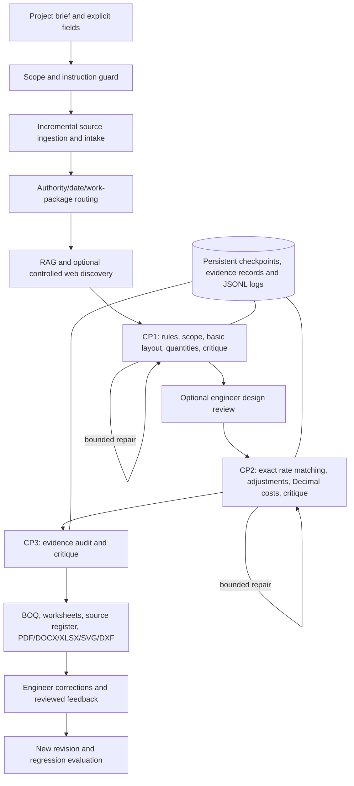

# Tenderworks: Evidence-backed government works estimation

**BTech final-project technical report — implementation and reproducible evaluation**  
Prepared: 17 November 2026. Currency: INR. Units: metric.

## Abstract

Tenderworks translates a public-works brief into a structured scope, basic dimensioned drawings, quantity worksheets, sourced rates and a draft estimate. It combines a fixed LangGraph workflow, specialist LLM reviews, document retrieval and deterministic arithmetic. The implemented contribution is controlled integration and traceability rather than autonomous engineering design. The final demonstration uses CPWD PAR 2025 for a narrowly defined office preliminary estimate. It preserves the distinction between official numerical transcriptions, assumed design parameters, unreviewed web material and synthetic fixtures.

The evaluation architecture isolates tools, agents, checkpoints and complete workflows. LangSmith SDK experiments retain per-case outputs and deterministic scores; pytest protects arithmetic, access, ingestion and workflow controls. Two installed Ollama models are compared on the same controlled agent dataset. Results are supplied in the measured-results section/artifact, including failures and evaluation limitations. The project is a production-oriented academic prototype; no claim of government certification, construction-ready drawings or independently validated real-project accuracy is made.

## 1. Problem, objectives and boundaries

Government estimating requires consistent specifications, applicable schedule editions, correct units and transparent calculations. A plausible natural-language answer is insufficient: a reviewer needs to locate each rate, reproduce each amount and understand every assumption. The system therefore accepts a project description and explicit form fields, selects a domain package, produces conditional quantities, applies compatible rates and reports evidence gaps.

Objectives are repeatable arithmetic, source traceability, controlled research, visible uncertainty, human review, durable workflow state and reproducible evaluations. Detailed structural design, geotechnical interpretation, statutory sanction, automated procurement decisions and broad all-authority coverage are outside the validated scope.

## 2. Architecture and responsibility boundaries

The orchestrator is `EstimationWorkflow`, a LangGraph StateGraph with SQLite checkpoints locally and a PostgreSQL option. The graph owns progression. Models cannot create arbitrary transitions, approve estimates, write official rates or execute arbitrary code.

Logical roles include intake/routing, rules, scope, concept review, quantity estimation, quantity critique, rate matching, economics, pricing critique, evidence audit and optional research. These are not twelve independent autonomous deployments: deterministic services perform numerical work, while the selected model extracts facts or returns bounded review findings. The current Ollama adapter receives pre-retrieved evidence rather than autonomously invoking every available tool.

## 3. Evolution and engineering rationale

The project author reports that earlier high-autonomy designs produced unsuitable behavior for a workflow that normally follows prescribed stages. Checkpoints and LangGraph were introduced to constrain progression, while critique roles were added after observing poor outputs. These are **author-reported development observations**, not a controlled before/after accuracy experiment. The final benchmark does not establish a causal performance gain from critique agents or reduced autonomy.

The resulting design prioritizes reproducibility over open-ended debate. Scope repair handles selected omission/duplication codes; price repair handles arithmetic mismatch. Attempts are configurable from zero to five per checkpoint. An authorized user can skip remaining retries without terminating the rest of the workflow. Reaching the retry limit preserves unresolved findings; it does not manufacture a complete or approved estimate. Optional human review pauses after CP1, and final reviewed status is separately controlled.

## 4. Data acquisition and ingestion

The CPWD PAR 2025 publication was obtained from the official Railway Board publication index after the direct CPWD download returned a rejection page. PDF signatures were checked; HTTPS verification was retained. Source URLs, retrieval metadata, byte counts and SHA-256 fingerprints are stored in the manifests. Maharashtra PWD SSR 2022–23 and a Railway Board adoption notice were downloaded to a separate reference directory and were not ingested.

The pre-existing large DAR PDF was preserved outside the active inbox because its size exceeds the current inbox limit. No document was silently truncated to make a successful-ingestion claim. The selected PAR document and structured CPWD demo package are indexed. Full provenance and the exact archive locations are in `docs/DATA_SOURCES.md`.

Ingestion hashes file bytes plus sidecar metadata, extracts PDF text, chunks it, snapshots sources and indexes new/changed content. Unchanged files are skipped. pypdf reads selectable text; no OCR capability is claimed. Optional structured draft extraction remains available through the earlier NVIDIA integration, but the final CPWD demo uses explicitly mapped source rows instead of accepting unverified model-extracted prices.

RAG uses keyword/BM25 retrieval in the measured configuration. Existing optional embedding support can add semantic retrieval; it was not used to claim vector-search performance here. Document trust and applicability are separate from retrieval relevance.

## 5. Web retrieval and trust

Two research modes are implemented. Key-free `official` mode searches a fixed official publication index for the supported PAR document. `brave` mode performs broader search when a Brave key is configured. Both use an HTTPS allowlist, public-address checks, bounded responses/timeouts and revalidated redirects. Successful discoveries are cached for 24 hours per tenant. Queries use authority/catalog categories rather than private project descriptions.

Web sources enter as candidates. Even an official source may be obsolete or inapplicable to a project, and a file in RAG is not automatically trustworthy. Candidate evidence is labelled advisory; findings explicitly disclose unreviewed retrieval. Only structured, applicable rate records participate in arithmetic. A missing source remains a gap rather than becoming an invented rate.

## 6. Geometry, quantities and pricing

The drawing engine generates rectangular layouts and stable element IDs. The same model supports dimensioned SVG, ReportLab PDF and ezdxf DXF outputs. It does not carry out structural analysis, geotechnical design, clash detection, service sizing or professional architectural optimization. These basic drawings are the principal engineering bottleneck: improving geometry and validated design templates could improve quantity estimates, but that expected benefit must be evaluated rather than asserted as a measured result.

Quantities carry supplied, concept-derived, allowance or unresolved labels. Formula execution is restricted to allowed arithmetic expressions and Decimal numbers. Scheduled rates require matching specification and units; non-scheduled analyses require supported resource inputs. Composite inclusions and adjustments are checked to prevent double counting. An evidence ledger links values to documents, calculations, design inputs and assumptions.

The official-rate demonstration is **a PAR preliminary estimate**, not a detailed DSR tender BOQ. It covers an explicitly bounded 300 m² Delhi office scenario. The rate rows and arithmetic are recorded in `docs/DATA_SOURCES.md`. External works and other excluded services must not be mistaken for zero-cost completed coverage. The final scope total is INR 11,028,540 at the selected 2025 basis; this is not a current-market quote or sanctioned project budget.

## 7. Guardrails and operational traceability

`docs/GUARDRAILS.md` defines the control criteria. Intake screening rejects obvious unrelated requests and explicit instruction overrides before LLM calls. Applicability checks reject unsupported package combinations. JSON schemas constrain model outputs, while exact evidence-ID/quote checks reject unsupported suggestions. The guard is heuristic and is not a complete prompt-injection defence; numerical authority is deliberately outside the model as a second boundary.

JSONL logs retain node inputs/outputs, model answers, failures, roles, duration and token counts under tenant/revision-separated paths. Hidden chain-of-thought is not captured. Redaction replaces text with hashes when configured; retention is enforced by an explicit purge command. The application does not silently export these logs to LangSmith. Curated benchmark upload is opt-in. Existing roles and tenant filters protect access, including the new skip-corrections endpoint.

## 8. Evaluation design

The full methodology is in `evals_final.md`. The implemented development dataset contains intake, specialist-defect, clean-critic, guardrail, retrieval, checkpoint and complete-workflow cases. It is developer-labelled, small and not independent of development. Numerical reference assertions are explicit; the CPWD example uses a separately written arithmetic reference. Per-case failures remain in denominators.

The four evaluation levels answer different questions:

1. Tool/engine tests establish local arithmetic, integrity and access properties.
2. Agent evaluations test explicit extraction and evidence-grounded defect detection on controlled inputs.
3. Checkpoint evaluations supply deterministic upstream fixtures to isolate downstream responsibilities.
4. Workflow evaluations test whether a project reaches the correct final state, including correct refusal/abstention.

LangSmith SDK runs experiments locally without credentials and can upload to a configured workspace. Metrics include field precision/recall, quote grounding, defect-detection proxies, arithmetic exactness, structural evidence coverage, model availability, source recall@k and latency. Critic scores based on IDs and substring quotes are not semantic-entailment guarantees; independent human adjudication is needed. No calibrated confidence score or automatic fine-tuning is claimed.

## 9. Benchmark protocol and measured results

See `MEASURED_RESULTS.md`, generated from actual `eval/results/*/summary.json` files. The two-model comparison uses identical agent cases, structured-output schemas and prompt version, temperature zero and sequential execution on the same Mac. Model digests and quantization are recorded. The broader first Qwen run is a separate development experiment with an earlier review budget; it must not be compared as if it used the final configuration.

Final local verification passed 56 pytest tests, Ruff checks, JavaScript syntax validation and diff whitespace checks. The preview health endpoint responded successfully. The machine-readable record is `eval/results/validation.json`. Hosted LangSmith upload was not exercised because credentials were not supplied.

The final V3 isolated-agent comparison recorded **5/14 reference passes for Qwen 2.5 3B** and **9/14 for Gemma 3 (installed 4.3B quantization)**. All 14 calls executed for each model, but execution success did not imply correct extraction or grounded critique. Median target latencies were 13.17 and 10.02 seconds respectively. The saved source-tree and dataset hashes match within this comparison. These results do not meet a claim of autonomous engineering reliability.

Single-repetition outcomes are demonstrations, not stable model rankings. Warm/cold loading, prompt length and shared-memory pressure affect latency. Per-run Wilson intervals are descriptive; repeated cases are correlated. No monetary inference-cost figure is fabricated for local Ollama.

## 10. Problems encountered and solutions

| Problem | Implemented response | Remaining limitation |
|---|---|---|
| Direct official download blocked / rejected HTML | Validated PDF bytes and used the official Railway Board-hosted publication | Publisher availability can still change |
| PDFs searchable but no executable pricing mapping | Added a source-backed, scope-limited PAR domain package | A full detailed DSR package still needs engineering review |
| Large DAR exceeds inbox limits | Preserved original outside the inbox; used manageable PAR source | Large-volume splitting/OCR still require preprocessing |
| Exclusion lists accidentally selected HVAC | Clause-level exclusion handling plus regression test | Complex mixed positive/negative language remains a parsing challenge |
| Thousands separators could change quantities | Numeric separator normalization and a 2,400 m² regression case | Broad locale/number-language support needs more cases |
| Unbounded review verbosity was slow locally | Bounded arrays/strings, configurable output tokens and timeout; explicit intake field/number contract | Local models remain slower and less reliable on long contexts |
| Fixed retry policy lacked user control | Configurable attempts and an audited skip-retries action | Skipping cannot resolve unsupported engineering data |
| Trace summaries omitted actual model answers | Structured local model/node logs and answer payloads in trace usage | Logs require access control, retention and privacy policy |
| Framework local-eval mode attempted nested trace upload | Explicitly disabled nested tracing for local benchmark targets | Hosted upload still needs valid credentials and organizational approval |
| New Gemma download rejected by installed Ollama version | Used an already installed model for comparison instead of changing system Ollama | Upgrading Ollama remains an operator action |

The V2 model-role benchmark exposed a contract mismatch: models returned numeric values with units and unsupported field names. V3 explicitly constrains field names and requests unit-free numeric strings. One ambiguous intake reference label was corrected and two diagnostic cases were added; the versioned datasets and earlier failures remain available. V2 and V3 aggregate scores are therefore not a controlled causal before/after comparison. A truncated integrated development run was stopped, marked failed and preserved in the local audit logs before re-testing the corrected budget.

## 11. Remaining shortcomings and production readiness

The project now has reproducible evaluation infrastructure and a working scoped demonstration. It is not yet proven safe for unsupervised government procurement. Required future work includes independent engineering labels, a project-family-held-out benchmark, calibrated semantic judges, broader applicable rate editions/correction slips, dimensional design validation, stronger SSRF/network controls, robust multilingual intent handling, deployed authentication/HTTPS, load testing, backup/restore drills and operational incident monitoring.

Critique suggestions are advisory and do not automatically alter official numbers. Feedback is reviewed and can lead to new revisions or regression cases; it does not directly train the model. A larger compute budget can permit more review attempts, but additional retries must demonstrate improvement and cannot repair missing authoritative evidence by themselves.

## 12. Conclusions and future work

Tenderworks demonstrates a controlled path from brief to an auditable, scope-limited draft with source links and reproducible calculations. The main engineering lesson is to separate model interpretation from numerical authority and make failures visible. Its evaluation harness is designed to expose weaknesses rather than conceal them behind confidence scores.

Priorities are better drawing/design capability, independently reviewed CPWD quantity/rate packages, semantic citation evaluation, wider real-project benchmarks and deployment hardening. The data model, checkpoints, evidence ledger and retained logs provide a foundation for those improvements without asserting that they have already been achieved.

## Reproduction and references

- Start/demo commands: repository README and `scripts/run_demo.py`.
- Evaluation protocol: `evals_final.md`; raw results: `eval/results/`.
- Source manifests: `reference_documents/download_manifest.json` and `docs/DATA_SOURCES.md`.
- [CPWD PAR 2025 official-hosted PDF](https://rb.indianrailways.gov.in/uploads/directorate/civil_engg/2025/PLINTH_AREA_RATES_2025%20%281%29.pdf).
- [LangSmith local experiments](https://docs.langchain.com/langsmith/local).
